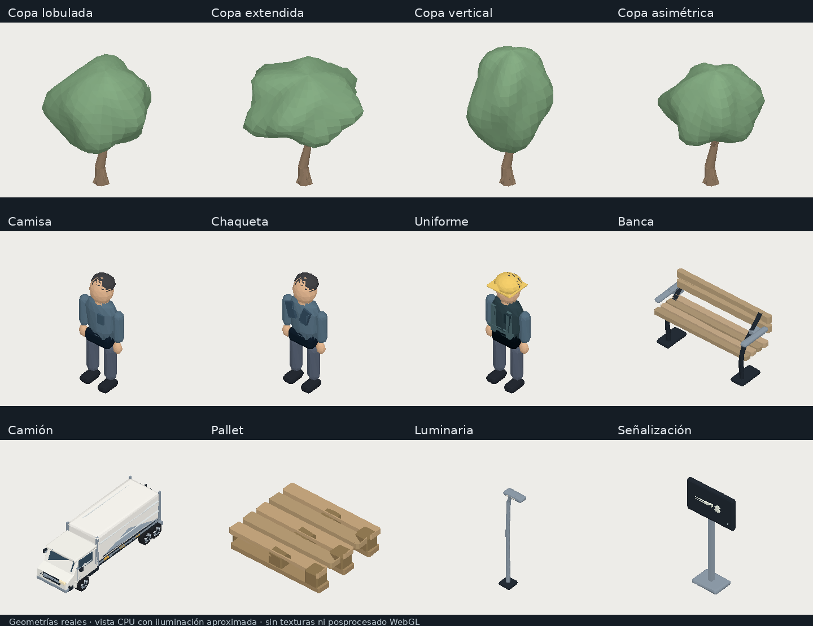

# Arxnet · pasada de refinamiento de objetos

Esta pasada conserva el Shell, las posiciones de los departamentos, las vías, la navegación y los ciclos de actividad. El mundo continúa usando Three.js directo; no se ha introducido una migración a React Three Fiber ni dependencias nuevas.

## Refinamiento aplicado

- **Árboles:** cuatro copas diferentes —lobulada, extendida, vertical y asimétrica— con variación determinista de escala, giro y tono. Troncos curvados por tramos, bifurcaciones y raíces ensanchadas. Se mantienen cipreses y arbustos, y cada copa tiene una versión reducida. Los ejemplares interiores pequeños mantienen la copa compacta para caber en su recinto.
- **Personas:** torso de perfil anatómico con cintura y hombros; tres prendas (camisa, chaqueta y uniforme con bandas), proporciones variadas, distintos tonos de piel y posturas. Las manos tienen material y tono de piel propios, separados de las mangas. Se conservan los recorridos y las animaciones de caminar y trabajar.
- **Vehículos:** carrocería de cabina con perfil inclinado, parabrisas acorde al volumen, guardabarros curvos, chasis con largueros y travesaños y nervaduras de carga. Se conservan ruedas, remates, herrajes y trayectorias existentes.
- **Logística:** pallets con esquinas achaflanadas, tablones separados, bloques de apoyo y huecos reales para las horquillas. Apilado de cajas con pequeñas variaciones de posición, dimensiones y giro, manteniendo el apoyo y reduciendo los huecos verticales. Se conserva la cinta y etiquetado en volumen. Los contenedores tienen separaciones verticales menores para evitar pilas visualmente flotantes.
- **Mobiliario urbano:** bancas de listones con estructura tubular y apoyabrazos soportados; luminarias con cuello curvo, placa base y difusor; bolardos y señales de orientación colocados sobre las aceras. No se añaden luces puntuales.
- **Materiales:** acabado de madera mate con grano y normal suaves para pallets y bancas; pintura menos metálica; ajustes de vidrio y metal para ambos temas. Se mantiene el asfalto procedural y la iluminación existente.
- **Profundidad:** sombras de contacto elípticas que siguen los pies, también en calidad baja. Reutilizan la textura suave existente, sin un pase de posprocesado ni un destino de render adicional. Las sombras direccionales suaves existentes permanecen en los perfiles que las permiten.

La vegetación de toda la escena se agrupa en un máximo de seis lotes: cuatro copas, ciprés y arbusto. Los colores se actualizan al cambiar de tema, y la selección de una copa sigue identificando su departamento por instancia. Se mantienen los límites y variantes de los perfiles gráficos.

## Impacto medido y estimado

Las cifras siguientes son conteos geométricos en CPU, con instancias y elementos ocultos incluidos, en perfil alto. No son FPS ni draw calls efectivos del navegador.

| Organización | Triángulos antes → después | Aumento | Lotes instanciados antes → después | Aumento de buffers de escena (MiB) |
| --- | ---: | ---: | ---: | ---: |
| Norvik Industrial | 535,620 → 582,414 | +8.7% | 78 → 69 | 0.32 |
| Mercato Group | 391,466 → 433,814 | +10.8% | 70 → 63 | 0.32 |
| Lumen Consultores | 273,472 → 296,270 | +8.3% | 62 → 55 | 0.30 |

El JavaScript total pasa de 988,884 a 996,932 bytes (+8,048); gzip calculado con Node aumenta 2,674 bytes. Los buffers geométricos de escena suben aproximadamente 0,30–0,32 MiB. Las dos texturas nuevas de madera tienen 128×128 píxeles; su coste nominal RGBA8 con mipmaps ronda 0,17 MiB en conjunto, sin contar decisiones internas del driver.

**Estimación:** coste geométrico y de actualización de actores algo mayor, compensado parcialmente por menos lotes de vegetación. El grupo global de copas también cambia la granularidad del culling: una cámara enfocada puede procesar más vegetación que antes. No se afirma una mejora neta de FPS. Se conservan calidad adaptativa, DPR limitado, copas reducidas y desactivación de sombras/posprocesado en calidad baja.

Los registros [previo](object-pass-before.json) y [posterior](object-pass-after.json) permiten revisar todos los perfiles. `object-pass-baseline.json.gz` conserva el código anterior de mundo, datos y kit de objetos.

## Verificación y lectura visual

Pasan **lint, build y 39 pruebas**. Las seis pruebas nuevas cubren las cuatro copas, agrupación y propietarios, selección por instancia, ropa y tonos de manos, contacto con el piso y huecos del pallet. Se mantienen las 33 pruebas de interacción, temas, rutas, perfiles, contacto, movimiento reducido y liberación de recursos.



La galería usa las geometrías reales y un rasterizador en CPU con iluminación aproximada. No reproduce texturas, sombras, transparencia, reflejos ni interpolación de normales de WebGL. No es una captura del navegador.

Este entorno sigue sin poder iniciar Chromium. No se han medido FPS, tiempos GPU ni comportamiento en un móvil físico. Es necesaria una revisión local de los acabados PBR y del rendimiento, especialmente con una cámara enfocada y en teléfonos. El build mantiene el aviso de Vite por el tamaño del módulo del mundo.

## Simplificaciones que permanecen

Los rostros siguen siendo mínimos y no hay deformación de codos o rodillas: se usa articulación de piezas instanciadas. El montacargas, HVAC y maquinaria secundaria conservan parte de su geometría simplificada. Herrajes, rótulos y objetos pequeños omiten microdetalle que no se lee desde la cámara. Algunos conjuntos pequeños comparten un material con colores de vértice para limitar el coste.

## Ejecutar

```sh
pnpm dev
pnpm test
pnpm measure:world
```

Para regenerar la galería, con Python, NumPy y Pillow disponibles:

```sh
node scripts/export-world-preview.mjs --before
node scripts/export-world-preview.mjs
python scripts/render-object-gallery.py
```

La galería muestra los objetos actuales; el comparativo general usa la base inicial del mundo. `--objects-before` permite exportar la base inmediatamente anterior a esta pasada.
