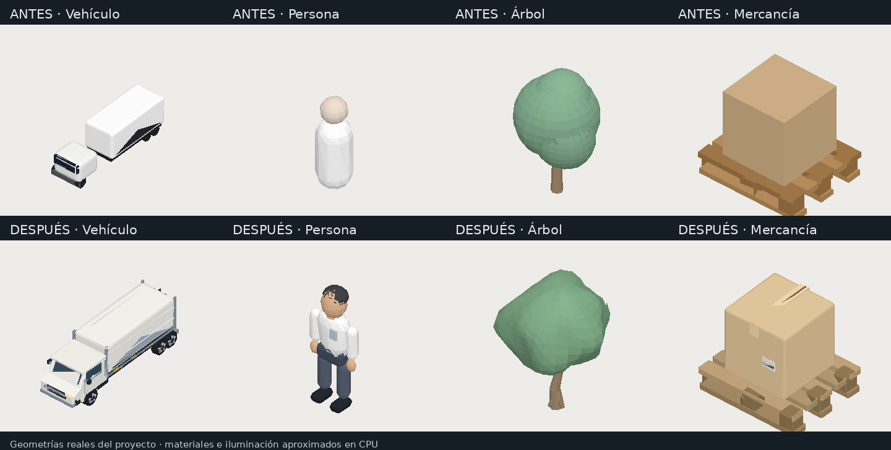
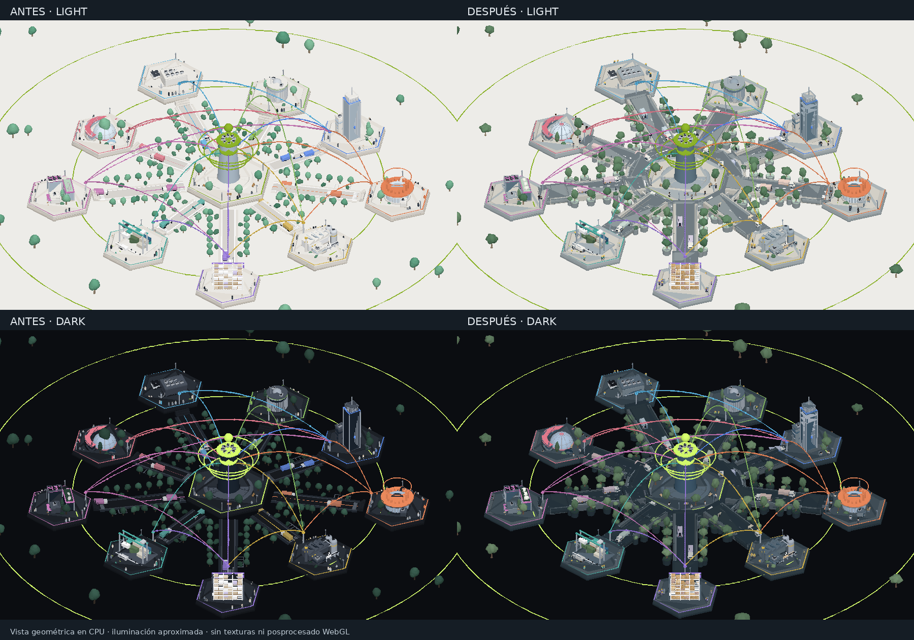

# Arxnet · refinamiento integral del mundo 3D

Se ha aplicado una intervención global sobre el escenario, manteniendo la disposición radial, las identidades de los departamentos, los flujos de información y el Shell empresarial. La escena conserva su carácter conceptual y tecnológico; utiliza objetos construidos con volumen y proporciones reconocibles.

La [pasada posterior de objetos](object-pass.md) añade variantes de vegetación y ropa, mobiliario y nuevos acabados; sus métricas separan ese coste del refinamiento inicial.

## Arquitectura comprobada

El mundo usa Three.js directamente, con `ArxWorld` como propietario de escena, cámara, interacción, animaciones y recursos. La interfaz usa React. Las dependencias de React Three Fiber y Drei están instaladas, pero no participan en este escenario. No se usan GLTF, modelos remotos ni descargas de activos 3D.

- `src/arxnet/world.ts`: construcción espacial, arquitectura de los nueve tipos de distrito, materiales PBR, calles, instancing, cámara, perfiles y actividad.
- `src/arxnet/premium.ts`: kit reutilizable de geometrías, anatomía, vehículos, mercancía, mobiliario, copas, ramas, rampas y trayectorias.
- `src/arxnet/data.ts`: configuración empresarial, departamentos, indicadores, conexiones y tokens de los temas.
- `src/arxnet/ArxnetShell.tsx`: se conserva la interfaz; su integración carga el mundo mediante importación dinámica y cancela el inicio si React desmonta el componente.

La representación sigue derivándose de la configuración de cada organización. Se mantienen los presets de 5, 7 y 9 departamentos y sus relaciones, sin sustituir el sistema de configuración del ERP.

## Cambios constructivos

**Calles.** Boulevard circular alrededor del núcleo, calles radiales y explanadas de giro. Pavimentos, plataformas y accesos comparten el nivel de circulación de 0,63 unidades. Las calles tienen bases sólidas, aceras y bordillos; se han retirado las escaleras que bloqueaban las rutas. Los extremos se solapan con el boulevard y con las entradas de los departamentos. Hay cruces y marcas estáticas de circulación. Las entradas de edificios elevados incorporan rampas sólidas.

**Vehículos.** Cabina proporcionada con techo, capó, ventanas, parabrisas, retrovisores, parrilla, luces, puertas, manillas y parachoques. La caja de carga tiene chasis, remates, puertas, herrajes y reflectores. Cristales y neumáticos tienen materiales diferentes del resto del vehículo. Las seis ruedas se instancian y giran en función de la distancia recorrida.

Las rutas son circuitos cerrados con rectas y semicírculos, tangentes continuas y velocidad constante. Los dos vehículos de cada ruta comparten velocidad y mantienen su separación. El camión estacionado de Logística tiene cabina, carga y ruedas alineadas y apoyadas sobre el piso, junto al muelle.

**Personas.** Torso, pelvis, cuello, cabeza, cabello, manos, brazos, piernas y zapatos, con ropa y piel separadas. Los departamentos industriales usan uniformes y cascos; Legal conserva vestimenta de oficina. Brazos y piernas usan instancing, sin esqueletos pesados ni motores físicos. La marcha mueve las extremidades y corrige la altura del cuerpo para evitar que los zapatos atraviesen el pavimento. Hay personas quietas y trabajadores frente a consolas, fuera de la franja principal de circulación peatonal.

**Vegetación.** Copas suaves de silueta irregular, coloración por altura y normales compartidas en las costuras. Troncos con bifurcaciones y ramas. Árboles, cipreses y arbustos tienen geometrías compartidas y variantes de detalle. Se reduce la densidad paisajística; la vegetación junto a las calles se apoya en jardineras. El árbol interior de la cúpula cabe bajo su cubierta.

**Arquitectura.** Se conservan las torres, edificios circulares, naves, almacenes abiertos, muelles, campus, cúpulas, tecnología y laboratorios. El constructor común añade modulación física de fachadas, bandas de pisos, montantes, ventanas, alféizares, marcos, puertas, marquesinas y accesos. Se mantienen cubiertas, parapetos, climatización, paneles y equipos específicos de cada tipología.

**Operaciones.** Cajas con bordes suavizados, juntas, cinta y etiquetas en volumen; contenedores con corrugación, cantoneras y cierres; pallets de listones y soportes. Se incorporan escritorios, monitores, servidores y consolas. Los estantes conservan montantes y travesaños; se ajusta el apoyo de las cargas. El montacargas retrocede sin girar instantáneamente ni invertir su mercancía, y su recorrido de elevación se mantiene dentro del mástil. La carga suspendida de la grúa circula por encima de las pilas de contenedores.

## Materiales, iluminación y temas

Se calibran hormigón, metal, vidrio, pavimento, cartón, vegetación, ropa, piel y caucho con materiales estándar PBR y texturas procedurales existentes o generadas localmente. El asfalto incorpora grano y normal suave. Los detalles estáticos se agrupan por material; las piezas de menor escala usan colores de vértice para conservar un presupuesto de lotes razonable. Ese recurso agrupa algunos acabados de mobiliario y equipamiento bajo una misma rugosidad, en lugar de asignar un material a cada tornillo o herraje.

El modo claro usa pavimentos más contrastados, vidrio azul gris y hormigón cálido, evitando un mundo completamente blanco. El oscuro aumenta la legibilidad de los edificios, diferencia las superficies y reduce la emisión de ventanas y remates. No se cambian los tokens visuales del Shell ni los colores identificativos de los departamentos.

Se conserva el posprocesado existente, con oclusión más moderada y bloom reducido. El antialiasing del destino HDR baja de cuatro a un máximo de dos muestras. Si no hay soporte HDR se utiliza renderizado directo; si falla el entorno de reflexión se conserva la misma geometría con iluminación ambiental y direccional. No se introduce un fallback de personajes o vehículos simplificados.

## Animación y perfiles

Las cámaras, el enfoque, la rotación ambiental, el zoom y los flujos se conservan. La marcha y la circulación utilizan tiempo, sin cambios aleatorios de dirección por fotograma. La preferencia de movimiento reducido congela actividad y texturas de flujo, evita destellos de etiquetas y pulsos expansivos, y conserva vuelos de navegación cortos. Los cambios de esa preferencia se escuchan durante la sesión.

| Perfil | DPR máximo | Sombras | Copas | Posprocesado |
| --- | ---: | --- | --- | --- |
| Baja | 1 | Desactivadas | Geometría reducida | Render directo |
| Equilibrada | 1,3 | 1024 | Detalladas | Bloom en oscuro; directo en claro |
| Alta | 1,8 | 2048 | Detalladas | AO; bloom en oscuro |
| Auto | Según nivel | Según nivel | Según nivel | Desciende cuando el FPS medido permanece bajo |

Al cambiar de perfil se sustituyen las geometrías de copa y se invalidan los límites de culling correspondientes. La liberación cubre geometrías compartidas, variantes no visibles, texturas propias, instancias, mapas de sombras, destino de entorno y pases de posprocesado. El desmontaje es idempotente.

## Comparativa visual

Las imágenes siguientes se calculan **a partir de las geometrías reales**, con una cámara común antes y después. Son renders geométricos en CPU, no capturas del navegador. Su iluminación y materiales son aproximados: no reproducen texturas, sombras, transparencia, reflejos ni posprocesado WebGL. El rasterizador sombrea por triángulo; Three.js interpola las normales de los materiales suaves. Las imágenes sirven para comparar construcción y distribución, no para certificar el acabado final en GPU.





## Métricas y validación

Consulta [las métricas comparadas](world-metrics.md), [el registro anterior](world-before.json) y [el posterior](world-after.json). Los registros identifican el código de `world.ts` y contienen cantidades de geometría y medidas de construcción en CPU; no son resultados de FPS o draw calls.

Pasan `pnpm lint`, `pnpm build` y **39 pruebas**: las 10 de interacción, 23 de construcción y actividad y 6 de variantes y objetos. Las pruebas nuevas comprueban matrices finitas, calles y giros, temas, identidad de departamentos, perfiles, contacto de ruedas y zapatos, huellas de ruedas sobre las vías, rampas, movimiento reducido, colores de piezas compuestas, reconstrucción de organizaciones y liberación de recursos.

La comprobación de contacto es geométrica y por muestras de animación; no es una simulación física ni una prueba exhaustiva de colisiones de todos los objetos. Se revisaron además las vistas de geometría antes/después y se corrigieron los contactos descritos arriba.

**Limitación real:** Chromium no puede iniciarse en este entorno (`shutdown: Operation not permitted`); Vite tampoco pudo abrir el puerto local en la revisión previa (`listen EPERM`). No se ha comprobado el renderizado WebGL, el acabado PBR, FPS, consumo GPU ni funcionamiento en móviles físicos. Las pruebas omiten el constructor GPU, conservan los controladores reales y usan objetos mínimos de renderer y canvas para construir las escenas en CPU. El build valida los tipos y la resolución de módulos, pero no sustituye esa comprobación de navegador.

El módulo del mundo sigue superando el umbral de 500 kB de Vite. La carga se divide entre Shell y mundo, pero ambos se descargan durante el arranque normal; la división reduce el bloque inicial, no el total transferido.

## Ejecución local y revisión final de navegador

```sh
pnpm dev
```

Revisar las tres organizaciones en ambos temas, selección desde edificios y paneles, vuelos y zoom durante el vuelo, cambio de tamaño, ajustes de actividad y los perfiles de `App.tsx`. Probar 1440×900, 390×844 y 320×568, además de un teléfono físico. Confirmar consola limpia, uniones de pavimentos, sombra de contacto y contraste del vidrio.

En desarrollo, después de iniciar la ciudad, `window.arxnetDiagnostics()` devuelve contadores reales de `renderer.info`, el perfil, DPR, población y la muestra de FPS disponible en Auto. Los contadores del fotograma incluyen los pases de renderizado que hayan ocurrido; no deben compararse con el conteo CPU de triángulos construidos como si fueran la misma magnitud.

```sh
pnpm test
pnpm measure:world
node scripts/measure-world.mjs --before
```

`docs/world-baseline.json.gz` conserva el código previo de mundo y datos y las medidas del bundle previo. Los scripts restauran esa base en `/tmp` para que la comparación pueda reproducirse. Para regenerar las imágenes, con Python, NumPy y Pillow disponibles:

```sh
node scripts/export-world-preview.mjs --before
node scripts/export-world-preview.mjs
python scripts/render-world-preview.py
```

## Procedencia de activos

Todos los activos nuevos son geometrías procedurales locales en `premium.ts`. No se han descargado modelos, imágenes ni materiales de terceros, ni añadido dependencias de aplicación. Se reutilizan las utilidades de la instalación existente de Three.js. Las fuentes web del Shell permanecen como estaban.

Las apps del prototipo continúan mostrando datos de demostración. Este refinamiento no implementa backend ni CRUD del ERP.
